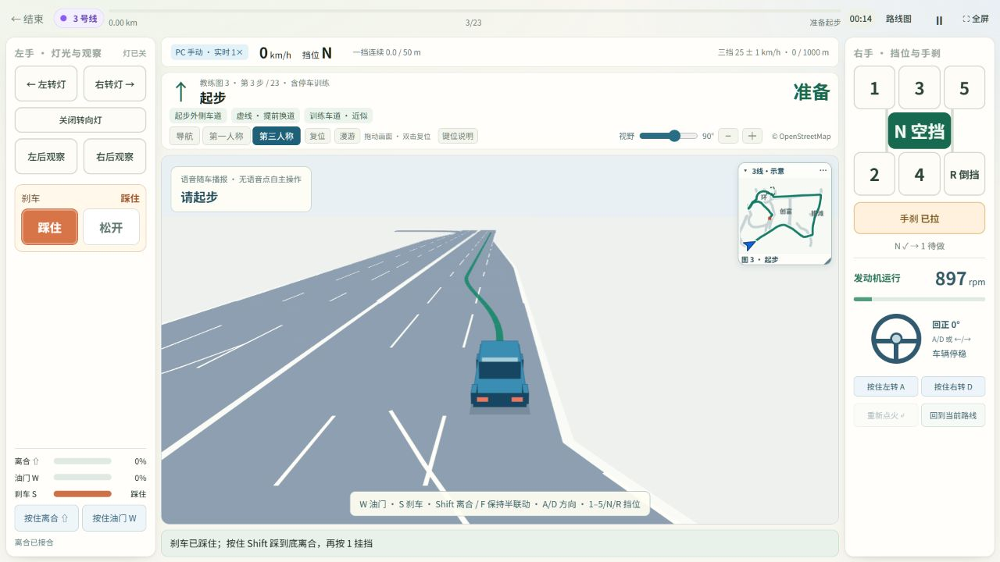
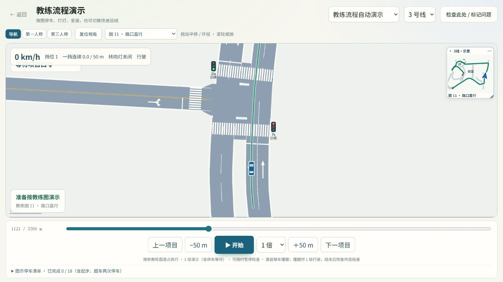
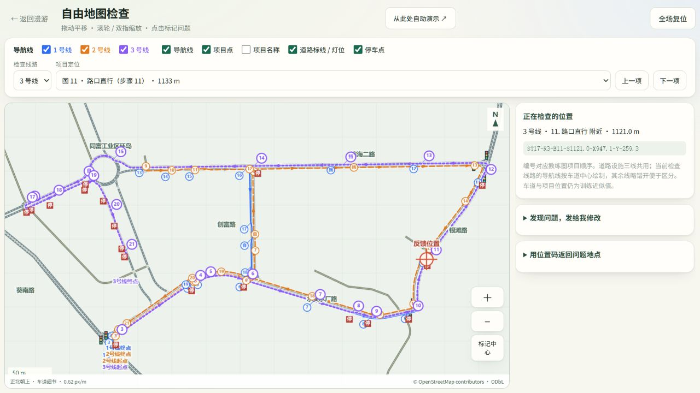

# 水头科三模拟器

一个 vibecoding 作品，练习深圳水头科目三手动挡流程。

[在线演示](https://bai-lugan.github.io/shuitou-kesan-simulator/)

## 功能

- 1 / 2 / 3 号线，导航、第一人称、第三人称视角和路线小地图。
- 适配手机竖屏、横屏和 PC，支持模拟灯光练习。
- 语音与停车、变道、超车训练，支持教练流程演示和自由练习。
- PC 键盘控制离合、油门、刹车、方向和挡位；地图支持拖动、缩放和位置反馈。

## 截图

下载后直接打开 `index.html`。训练示意，非官方考试系统。
